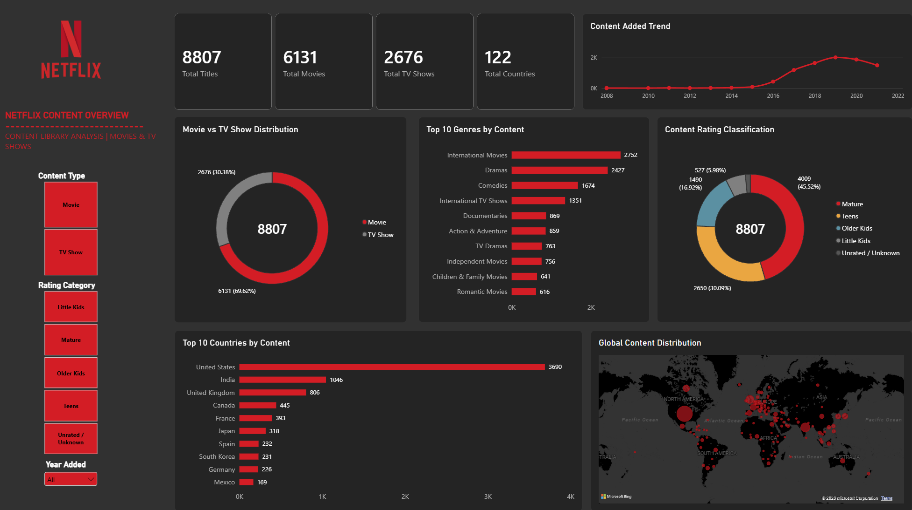
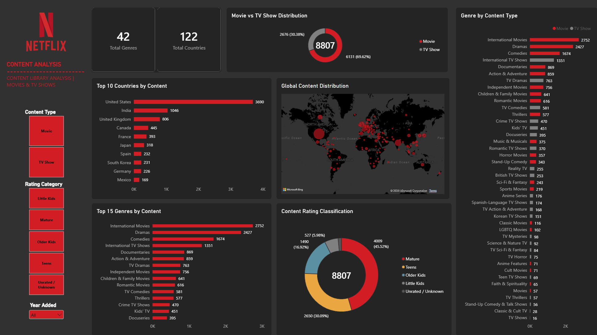
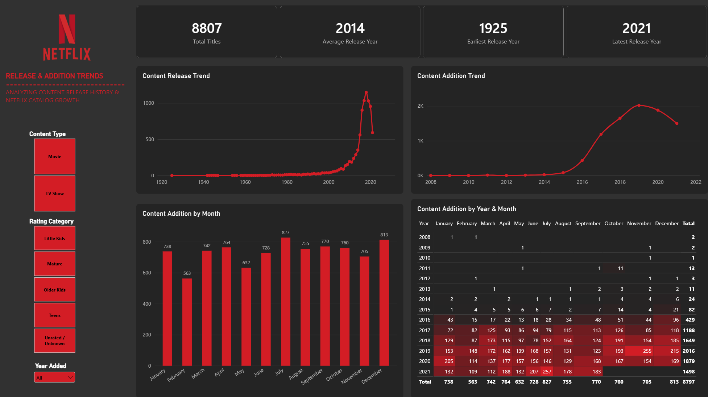
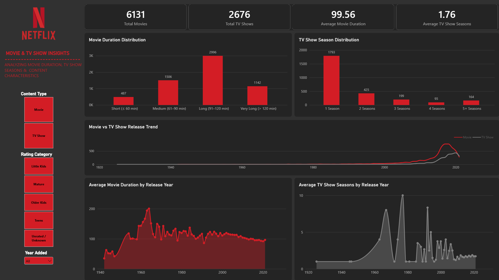

# 🎬 Netflix Movies and TV Shows Data Analytics

## 📌 Project Overview

This project focuses on analyzing the Netflix Movies and TV Shows dataset to explore the composition, distribution, and characteristics of Netflix's content catalog.

The analysis covers several aspects, including content types, production countries, genres, content ratings, release years, catalog addition trends, movie durations, and TV show season distributions.

The project follows a data analytics workflow using **Python, PostgreSQL, and Power BI**, starting from data understanding and cleaning, followed by exploratory data analysis (EDA), SQL-based analysis, and interactive dashboard development.

The main objective is to transform raw Netflix catalog data into meaningful insights and data-driven recommendations that can support a better understanding of content distribution and catalog characteristics.

---

## 🎯 Project Objectives

The main objectives of this project are:

1. Understand the structure and characteristics of the Netflix dataset.
2. Identify and handle missing values, invalid data, and inconsistencies.
3. Perform Exploratory Data Analysis (EDA) to discover patterns and trends.
4. Use SQL to perform data exploration, aggregation, and analytical queries.
5. Develop interactive Power BI dashboards to visualize important metrics.
6. Identify business insights related to content distribution and catalog trends.
7. Provide analytical recommendations based on the findings.

---

## 🛠️ Tools and Technologies

The following tools and technologies were used throughout the project.

| Tool | Purpose |
|---|---|
| Python | Data understanding, cleaning, and exploratory data analysis |
| Pandas | Data manipulation and transformation |
| NumPy | Numerical operations |
| Matplotlib | Data visualization |
| Seaborn | Statistical data visualization |
| PostgreSQL | Database management and SQL analysis |
| DBeaver | SQL development and database management |
| Power BI | Interactive dashboard development |
| Jupyter Notebook | Python analysis environment |
| Git & GitHub | Version control and project documentation |

---

## 📂 Dataset Description

The project uses the **Netflix Movies and TV Shows** dataset, which contains information about movies and TV shows available in the Netflix catalog.

### Dataset Summary

| Attribute | Value |
|---|---:|
| Total Records | 8,807 |
| Total Columns | 12 |
| Content Types | 2 |
| Unique Countries | 122 |
| Unique Genre Categories | 42 |
| Duplicate Records | 0 |
| Duplicate Show IDs | 0 |

### Dataset Columns

| Column | Description |
|---|---|
| `show_id` | Unique identifier for each title |
| `type` | Content type: Movie or TV Show |
| `title` | Title name |
| `director` | Director of the title |
| `cast` | Main cast members |
| `country` | Country or countries associated with the title |
| `date_added` | Date the title was added to Netflix |
| `release_year` | Original release year |
| `rating` | Content rating |
| `duration` | Movie duration or TV Show season count |
| `listed_in` | Genre categories |
| `description` | Short description of the title |

### Data Transformation

To support the analysis and Power BI dashboard, the original dataset was transformed into three analytical datasets:

| Dataset | Rows | Columns | Purpose |
|---|---:|---:|---|
| `netflix_tableau_main.csv` | 8,807 | 14 | Main content information |
| `netflix_country.csv` | 10,012 | 4 | Country distribution analysis |
| `netflix_genre.csv` | 19,323 | 4 | Genre distribution analysis |

The main dataset includes two additional numerical columns:

- `duration_minutes`: Movie duration in minutes.
- `season_count`: Number of seasons for TV Shows.

The country and genre datasets are separated because a single title can be associated with multiple countries and multiple genre categories.

---

## 🔄 Project Workflow

The project was conducted through the following analytical stages:

```text
                 RAW DATASET
                      |
                      v
              DATA UNDERSTANDING
                      |
                      v
                DATA CLEANING
                      |
                      v
           EXPLORATORY DATA ANALYSIS
                      |
                      v
              DATA TRANSFORMATION
                      |
                      v
                POSTGRESQL
                SQL ANALYSIS
                      |
                      v
                 POWER BI
              DATA MODELING
                      |
                      v
             INTERACTIVE DASHBOARD
                      |
                      v
               BUSINESS INSIGHTS
                      |
                      v
             BUSINESS RECOMMENDATIONS
```

### 1. Data Understanding

The initial stage focused on understanding the dataset structure, including:

- Dataset dimensions.
- Column names and data types.
- Data samples.
- Unique values.
- Descriptive statistics.
- Initial missing value identification.

### 2. Data Cleaning

The data cleaning process included:

- Identifying missing values.
- Handling missing categorical values.
- Correcting invalid content rating values.
- Extracting movie duration and TV Show season information.
- Converting `date_added` into datetime format.
- Checking duplicate records.
- Validating data consistency.

Missing values in `director`, `cast`, `country`, `rating`, and `duration` were handled using the value `Unknown`.

Ten missing values in `date_added` were retained because the original addition dates were unavailable and should not be artificially created.

Three malformed rating values that represented movie durations were corrected and transferred to the duration information.

### 3. Exploratory Data Analysis (EDA)

EDA was performed to identify patterns and distributions across the Netflix catalog.

The analysis included:

- Movie and TV Show distribution.
- Content additions over time.
- Monthly catalog addition patterns.
- Country distribution.
- Genre distribution.
- Content rating distribution.
- Movie duration analysis.
- TV Show season analysis.
- Release year distribution.

### 4. SQL Analysis

PostgreSQL was used to perform structured queries and analytical operations.

The SQL analysis includes:

- Basic SQL queries.
- Filtering and sorting.
- Aggregate functions.
- GROUP BY and HAVING.
- CASE WHEN statements.
- JOIN operations.
- Common Table Expressions (CTEs).
- Window functions.
- Business insight queries.

### 5. Power BI Dashboard Development

Power BI was used to build interactive dashboards for exploring the Netflix content catalog.

The dashboard development process included:

- Data import and transformation.
- Data modeling.
- Relationship creation.
- Date table creation.
- DAX measure development.
- Interactive visualizations.
- Slicer configuration.
- Dashboard formatting.

---

## 📊 Exploratory Data Analysis — Key Findings

### 1. Content Type Distribution

| Content Type | Total Titles | Percentage |
|---|---:|---:|
| Movie | 6,131 | 69.62% |
| TV Show | 2,676 | 30.38% |
| **Total** | **8,807** | **100.00%** |

**Insight:** Movies represent the largest portion of the Netflix catalog, accounting for approximately 69.62% of all titles.

### 2. Content Addition Trend

The top years by catalog additions are:

| Year Added | Total Titles |
|---|---:|
| 2019 | 2,016 |
| 2020 | 1,879 |
| 2018 | 1,649 |
| 2021 | 1,498 |
| 2017 | 1,188 |
| 2016 | 429 |
| 2015 | 82 |
| 2014 | 24 |
| 2011 | 13 |
| 2013 | 11 |

**Insight:** 2019 recorded the highest number of content additions, with 2,016 titles.

### 3. Top 10 Countries

| Country | Total Titles |
|---|---:|
| United States | 3,690 |
| India | 1,046 |
| United Kingdom | 806 |
| Canada | 445 |
| France | 393 |
| Japan | 318 |
| Spain | 232 |
| South Korea | 231 |
| Germany | 226 |
| Mexico | 169 |

**Insight:** The United States has the largest country contribution, followed by India and the United Kingdom.

### 4. Top 10 Genres

| Genre | Total Titles |
|---|---:|
| International Movies | 2,752 |
| Dramas | 2,427 |
| Comedies | 1,674 |
| International TV Shows | 1,351 |
| Documentaries | 869 |
| Action & Adventure | 859 |
| TV Dramas | 763 |
| Independent Movies | 756 |
| Children & Family Movies | 641 |
| Romantic Movies | 616 |

**Insight:** International Movies and Dramas are the two largest genre categories by title count.

### 5. Movie Duration Analysis

| Metric | Value |
|---|---:|
| Average Duration | 99.56 minutes |
| Median Duration | 98 minutes |
| Minimum Duration | 3 minutes |
| Maximum Duration | 312 minutes |

Duration distribution:

| Duration Category | Total Movies |
|---|---:|
| 60 minutes or less | 487 |
| 61–90 minutes | 1,506 |
| 91–120 minutes | 2,996 |
| More than 120 minutes | 1,142 |

**Insight:** The 91–120-minute category represents the largest movie duration group.

### 6. TV Show Season Analysis

| Season Category | Total TV Shows |
|---|---:|
| 1 Season | 1,793 |
| 2 Seasons | 425 |
| 3 Seasons | 199 |
| 4 Seasons | 95 |
| 5+ Seasons | 164 |

**Insight:** Approximately 67% of TV Shows have only one season, while approximately 82.9% have no more than two seasons.

---

## 🗄️ SQL Database Structure

The project uses PostgreSQL with the database and schema below:

```sql
CREATE DATABASE netflix_analytics;

CREATE SCHEMA netflix;
```

### Main Tables

| Table | Description |
|---|---|
| `netflix.netflix_titles` | Main Netflix content information |
| `netflix.netflix_country` | Country information associated with each title |
| `netflix.netflix_genre` | Genre information associated with each title |

### SQL Analysis Scripts

```text
sql/
│
├── 01_create_database.sql
├── 02_create_tables.sql
├── 03_data_validation.sql
├── 04_basic_analysis.sql
├── 05_aggregation_analysis.sql
├── 06_case_when_analysis.sql
├── 07_join_analysis.sql
├── 08_cte_analysis.sql
├── 09_window_functions.sql
└── 10_business_insights.sql
```

---

## 📈 Power BI Dashboard

The project contains four interactive dashboard pages designed to analyze different aspects of the Netflix catalog.

### Dashboard 1 — Netflix Overview

Provides a high-level overview of the Netflix content catalog.

**Key Visualizations:**

- Total Titles.
- Total Movies.
- Total TV Shows.
- Total Countries.
- Movie vs TV Show Distribution.
- Content Added Trend.
- Top 10 Countries by Content.
- Top 10 Genres by Content.
- Content Rating Distribution.



### Dashboard 2 — Content Analysis

Explores content distribution by genre, country, content type, and rating classification.

**Key Visualizations:**

- Total Genres.
- Total Countries.
- Content Type Distribution.
- Top 15 Genres.
- Global Content Distribution.
- Genre by Content Type.
- Content Rating Classification.



### Dashboard 3 — Release & Addition Trends

Analyzes original release years and Netflix catalog addition patterns.

**Key Visualizations:**

- Total Titles.
- Average Release Year.
- Earliest Release Year.
- Latest Release Year.
- Content Release Trend.
- Content Addition Trend.
- Content Addition by Month.
- Content Addition by Year and Month.



### Dashboard 4 — Movie & TV Show Insights

Explores the characteristics of Movies and TV Shows.

**Key Visualizations:**

- Total Movies.
- Total TV Shows.
- Average Movie Duration.
- Average TV Show Seasons.
- Movie Duration Distribution.
- TV Show Season Distribution.
- Movie vs TV Show Release Trend.
- Average Movie Duration by Release Year.
- Average TV Show Seasons by Release Year.




---

## 💡 Business Insights

The analysis identified several important findings:

1. **Movie-Dominated Catalog:** Movies account for 69.62% of the catalog, while TV Shows account for 30.38%.
2. **Global Content Representation:** The catalog contains titles associated with 122 countries, with the United States contributing the largest number.
3. **Genre Concentration:** International Movies and Dramas are the two largest genre categories.
4. **Content Rating Distribution:** Mature is the largest analytical rating group, representing approximately 45.52% of the catalog.
5. **Catalog Addition Peak:** 2019 recorded the highest number of content additions, with 2,016 titles.
6. **Movie Duration Profile:** The 91–120-minute category is the largest movie duration group.
7. **TV Show Season Profile:** Approximately 67% of TV Shows have one season.

For a more detailed explanation, see:

- [`business_insight.md`](business_insight.md)

---

## 🚀 Business Recommendations

Based on the findings, several areas are recommended for further evaluation:

1. Evaluate opportunities for international content diversification.
2. Review genre representation and potential content gaps.
3. Evaluate family and children's content opportunities.
4. Analyze one-season and multi-season TV Shows separately.
5. Monitor the balance between Movies and TV Shows.
6. Use monthly catalog addition patterns as a planning baseline.
7. Evaluate the movie duration profile.
8. Assess geographic concentration and representation.

These recommendations should be evaluated using additional data such as viewing hours, completion rates, subscriber information, content costs, and regional engagement.

For the complete recommendations, see:

- [`recommendation.md`](recommendation.md)

---

## 📁 Repository Structure

The following is the recommended repository structure:

```text
netflix-analytics/
│
├── notebooks/
│   ├── 01_Data_Understanding.ipynb
│   ├── 02_Data_Cleaning.ipynb
│   └── 03_Exploratory_Data_Analysis.ipynb
│
├── sql/
│   ├── 01_create_database.sql
│   ├── 02_create_tables.sql
│   ├── 03_data_validation.sql
│   ├── 04_basic_analysis.sql
│   ├── 05_aggregation_analysis.sql
│   ├── 06_case_when_analysis.sql
│   ├── 07_join_analysis.sql
│   ├── 08_cte_analysis.sql
│   ├── 09_window_functions.sql
│   └── 10_business_insights.sql
│
├── dashboard/
│   ├── Netflix_Analytics.pbix
│   └── screenshots/
│       ├── 01_netflix_overview.png
│       ├── 02_content_analysis.png
│       ├── 03_release_addition_trends.png
│       └── 04_movie_tv_show_insights.png
│
├── data/
│   ├── netflix_tableau_main.csv
│   ├── netflix_country.csv
│   └── netflix_genre.csv
│
├── business_insight.md
├── recommendation.md
└── README.md
```

*Note: The structure above is a recommended organization. Adjust folder names and filenames to match the actual files in the repository. The original dataset and processed CSV files may be excluded from GitHub if repository size or dataset redistribution restrictions apply.*

---

## ⚠️ Data Limitations

Several limitations should be considered when interpreting the results:

1. **Catalog Metadata Only:** The dataset contains content information, not actual viewing or streaming performance.
2. **No Revenue Information:** Revenue, profit, production costs, and acquisition costs are not available.
3. **No Audience Engagement Data:** The dataset does not include views, watch hours, completion rates, or subscriber behavior.
4. **Multiple Countries:** A title can be associated with more than one production country. Therefore, country counts are not mutually exclusive.
5. **Multiple Genres:** A title can belong to multiple genre categories. Genre counts may exceed the total number of unique titles when aggregated.
6. **Missing Addition Dates:** Ten records have missing `date_added` values. These records were retained without inventing dates.
7. **Analytical Rating Groups:** The rating categories used in this project are simplified analytical groupings and are not an official unified Netflix classification.

Consequently, the findings describe catalog composition and addition patterns. They should not be interpreted as direct evidence of audience preferences, commercial success, or Netflix's internal business strategy.

---

## 👨‍💻 Author

**Data Analytics Portfolio Project**

This project was developed as part of a data analytics portfolio to demonstrate practical skills in:

- Data Understanding and Cleaning.
- Exploratory Data Analysis (EDA).
- Python Data Analysis.
- SQL Querying and Database Management.
- Data Modeling.
- DAX Measures.
- Power BI Dashboard Development.
- Business Insight Generation.
- Data-Driven Recommendations.

---

## 📌 Conclusion

This project demonstrates how raw content metadata can be transformed into structured analytical datasets, explored using Python and SQL, and presented through interactive Power BI dashboards.

By combining data preparation, exploratory analysis, database querying, visualization, and business interpretation, the project provides a comprehensive overview of the Netflix content catalog and highlights opportunities for further investigation.

